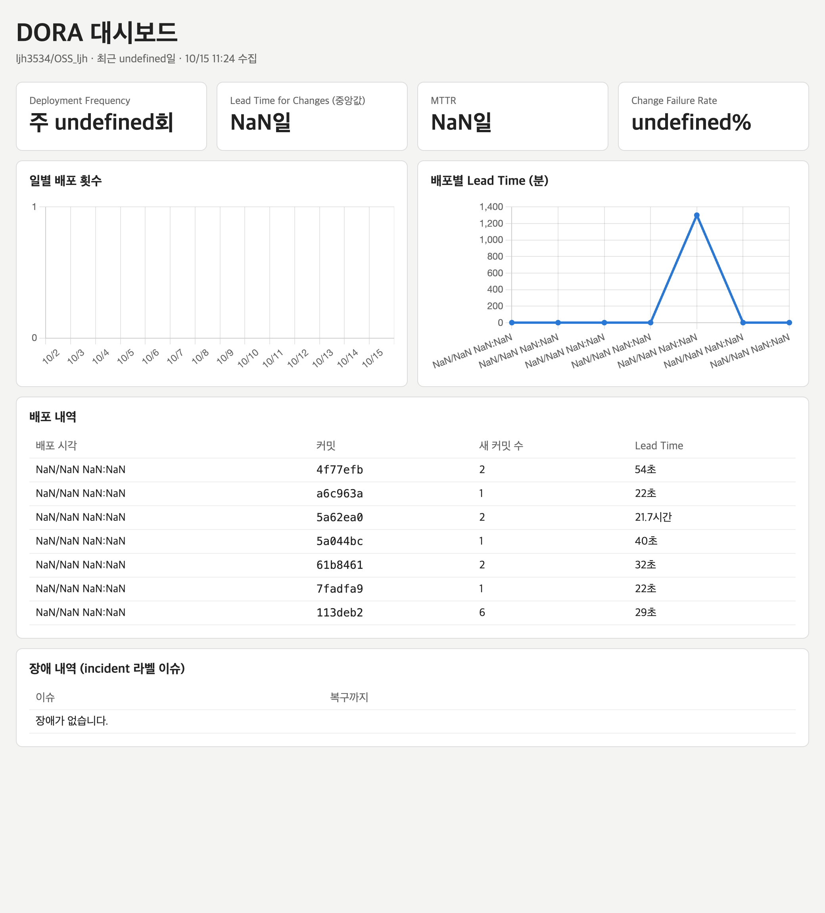

# OSS_ljh

오픈소스SW 수업 과제 저장소입니다. 학기 프로젝트 **TimeFit**(시간표 자동 조합 도우미)을 개발하면서, 주차별 실습(DORA 지표, GitHub Projects, CI/CD 등)을 이 저장소에 적용합니다.

- 프로젝트 제안서: [week01/PROPOSAL.md](week01/PROPOSAL.md)
- 프로젝트 보드: <https://github.com/users/ljh3534/projects/1>

| 주차 | 과제 | 결과물 |
|---|---|---|
| 1주차 | 개발 환경 설정 및 프로젝트 제안 | [환경 설정 기록](week01/README.md) · [프로젝트 제안서](week01/PROPOSAL.md) |
| 2주차 | DORA 메트릭 수집 자동화 | [설명](week02/README.md) · [워크플로우](.github/workflows/dora-metrics.yml) · [대시보드](https://ljh3534.github.io/OSS_ljh/) · [주간 보고서](reports/weekly) |
| 3주차 | GitHub Projects 계획·추적 체계 | [설명](week03/README.md) · [프로젝트 보드](https://github.com/users/ljh3534/projects/1) · [이슈](https://github.com/ljh3534/OSS_ljh/issues?q=is%3Aissue) · [마일스톤](https://github.com/ljh3534/OSS_ljh/milestones) |

## DORA 지표 현황

<!-- DORA:START -->
_2026-10-15 13:35 KST 자동 갱신 · [이번 주 보고서](reports/weekly/2026-W42.md)_

| 지표 | 값 |
|---|---|
| Deployment Frequency | 주 1.75회 (최근 28일 동안 7회) |
| Lead Time for Changes | 32초 (중앙값) |
| MTTR | — (장애 0건) |
| Change Failure Rate | 0.0% |
<!-- DORA:END -->

[](https://ljh3534.github.io/OSS_ljh/)

지표 정의와 수집 방식은 [week02/README.md](week02/README.md)에 정리했습니다.

## 저장소 구조

```
.github/
  ISSUE_TEMPLATE/      Bug / Feature 이슈 템플릿
  workflows/           배포(deploy.yml), DORA 수집(dora-metrics.yml)
docs/                  DORA 지표 대시보드 (GitHub Pages로 배포)
reports/weekly/        자동 생성되는 주간 DORA 보고서
scripts/               지표 수집·분석 스크립트 (Python 표준 라이브러리만 사용)
week01/ week02/ week03/  주차별 과제 설명
```
