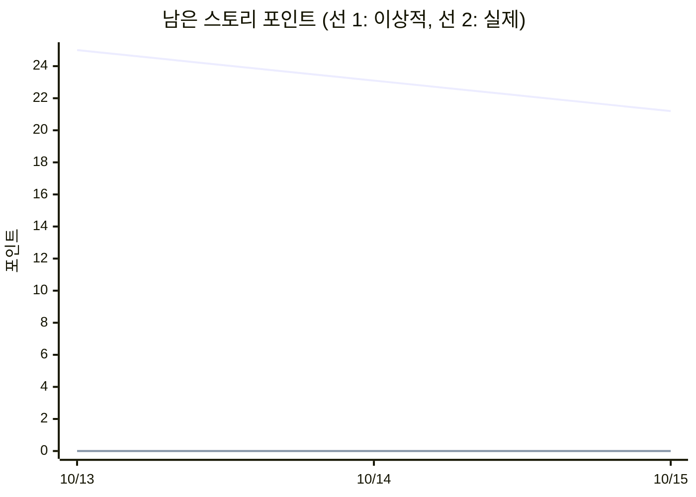

# 스프린트 지표 분석

_2026-10-15 10:52 KST 기준 · `scripts/sprint_metrics.py`가 자동 생성_

## Cycle Time

이슈 생성부터 종료까지 걸린 시간입니다. (보드의 In Progress 진입 시각은 API로 얻기 어려워 생성 시각을 시작점으로 사용)

| 완료 이슈 | 평균 | 중앙값 | 최소 | 최대 |
|---|---|---|---|---|
| 17건 | 18.0시간 | 7분 | 4초 | 43.6시간 |

| 이슈 | 포인트 | Cycle Time |
|---|---|---|
| [#1](https://github.com/ljh3534/OSS_ljh/issues/1) [Feature] DORA 4대 지표 수집 스크립트 구현 | 5 | 4분 |
| [#2](https://github.com/ljh3534/OSS_ljh/issues/2) [Feature] 지표 수집 GitHub Actions 워크플로우 (스케줄·수동 실행) | 3 | 4분 |
| [#3](https://github.com/ljh3534/OSS_ljh/issues/3) [Feature] GitHub Pages 배포 파이프라인 | 2 | 4분 |
| [#4](https://github.com/ljh3534/OSS_ljh/issues/4) [Feature] Chart.js 대시보드 | 5 | 3분 |
| [#5](https://github.com/ljh3534/OSS_ljh/issues/5) [Feature] 주간 보고서 자동 생성 및 JSON 아티팩트 저장 | 3 | 3분 |
| [#6](https://github.com/ljh3534/OSS_ljh/issues/6) [Chore] 이슈 템플릿(Bug/Feature)과 라벨 체계 정리 | 1 | 7분 |
| [#7](https://github.com/ljh3534/OSS_ljh/issues/7) [Docs] README에 대시보드 이미지와 지표 정의 정리 | 2 | 8분 |
| [#8](https://github.com/ljh3534/OSS_ljh/issues/8) [Feature] 스프린트 지표(Cycle Time·Velocity·Burndown) 분석 스크립트 | 3 | 7분 |
| [#9](https://github.com/ljh3534/OSS_ljh/issues/9) [Feature] 수집 스크립트 단위 테스트 및 CI | 3 | 43.6시간 |
| [#10](https://github.com/ljh3534/OSS_ljh/issues/10) [Feature] 다중 저장소 수집 지원 | 5 | 43.6시간 |
| [#11](https://github.com/ljh3534/OSS_ljh/issues/11) [Feature] 지표 악화 시 알림 이슈 자동 생성 | 3 | 43.6시간 |
| [#12](https://github.com/ljh3534/OSS_ljh/issues/12) [Feature] 대시보드 기간 필터 (7일/28일/90일) | 2 | 43.6시간 |
| [#13](https://github.com/ljh3534/OSS_ljh/issues/13) [Docs] 사용 가이드와 CONTRIBUTING 작성 | 2 | 43.6시간 |
| [#14](https://github.com/ljh3534/OSS_ljh/issues/14) [Feature] Grafana 연동 검토 | 0 | 43.6시간 |
| [#15](https://github.com/ljh3534/OSS_ljh/issues/15) [Feature] 재사용 가능한 GitHub Action으로 패키징 | 0 | 43.6시간 |
| [#16](https://github.com/ljh3534/OSS_ljh/issues/16) [Bug] 1분 미만 Lead Time이 "0분"으로 표시됨 | 1 | 4초 |
| [#17](https://github.com/ljh3534/OSS_ljh/issues/17) [Incident][훈련] 대시보드 접속 불가 상황 대응 훈련 | 0 | 8초 |

## Velocity

스프린트(마일스톤)별 계획·완료 스토리 포인트입니다.

| 스프린트 | 마감 | 이슈 (완료/전체) | 계획 포인트 | 완료 포인트 | 달성률 |
|---|---|---|---|---|---|
| Sprint 1 — 개발 인프라 (배포·DORA·백로그) | 10-26 | 9/9 | 25 | 25 | 100% |
| Sprint 2 — TimeFit MVP | 11-09 | 5/12 | 33 | 15 | 45% |

## Burndown

### Sprint 1 — 개발 인프라 (배포·DORA·백로그)

| 날짜 | 이상적 잔여 | 실제 잔여 |
|---|---|---|
| 10-13 | 25 | 0 |
| 10-14 | 23.1 | 0 |
| 10-15 | 21.2 | 0 |
| 10-16 | 19.2 |  |
| 10-17 | 17.3 |  |
| 10-18 | 15.4 |  |
| 10-19 | 13.5 |  |
| 10-20 | 11.5 |  |
| 10-21 | 9.6 |  |
| 10-22 | 7.7 |  |
| 10-23 | 5.8 |  |
| 10-24 | 3.8 |  |
| 10-25 | 1.9 |  |
| 10-26 | 0 |  |

### Sprint 2 — TimeFit MVP

| 날짜 | 이상적 잔여 | 실제 잔여 |
|---|---|---|
| 10-27 | 33 |  |
| 10-28 | 30.5 |  |
| 10-29 | 27.9 |  |
| 10-30 | 25.4 |  |
| 10-31 | 22.8 |  |
| 11-01 | 20.3 |  |
| 11-02 | 17.8 |  |
| 11-03 | 15.2 |  |
| 11-04 | 12.7 |  |
| 11-05 | 10.2 |  |
| 11-06 | 7.6 |  |
| 11-07 | 5.1 |  |
| 11-08 | 2.5 |  |
| 11-09 | 0 |  |
